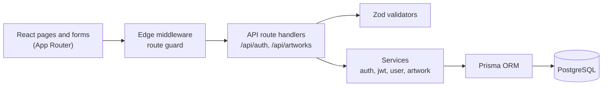

# The Five Doors

A full-stack web application to manage a museum's art collection: visitors create an account, staff catalogue and edit artworks through a protected admin area.

Built with Next.js 15, TypeScript, Prisma and PostgreSQL, with authentication written from scratch to understand every layer rather than delegate it to a service.

<!-- Screenshots: add the images to docs/screenshots/ and uncomment.
| Admin: artwork list | Admin: edit an artwork |
| --- | --- |
|  |  |
-->

## What it does

- **Accounts**: register, log in, log out, view and delete your profile.
- **Roles**: `VISITOR`, `STAFF`, `ADMIN`. Only staff and admins reach the admin area.
- **Artwork catalogue**: create, list (paginated), edit and delete artworks, from the admin UI or the REST API.
- **Validation**: every input is checked on the server with Zod, and the same schemas guide the forms.

## Architecture



Each layer has one job. Route handlers deal with HTTP (status codes, cookies), validators reject bad input early, services hold the business rules, and Prisma is the only code that talks to the database.

## Technical choices

- **Authentication written by hand, not outsourced.** JWT access token (15 min) and refresh token (7 days), both in `httpOnly`, `sameSite=strict` cookies, so page scripts cannot read them. Passwords are hashed with bcrypt.
- **Two checks, not one (defense in depth).** The middleware redirects unauthenticated users away from protected pages, and every protected API route checks the token and the role again. Calling the API directly does not bypass the rules.
- **Two JWT libraries, on purpose.** Next.js middleware runs on the Edge runtime, which has no Node.js `crypto` module, so it verifies tokens with `jose`. Route handlers run on Node.js and use `jsonwebtoken`.
- **Prisma migrations kept in the repository.** The schema history is readable and reproducible, from the first table to the role enum.
- **Typed errors at the boundary.** Validation failures return `400` with field details, missing auth `401`, wrong role `403`, unknown artwork `404`, conflicts `409`.

## Quality

- **77 tests** with Vitest and Testing Library: API routes (auth and artworks) and UI components (forms, modal, toast).
- **Continuous integration** on every pull request: lint, type check, tests, production build. `main` is protected: merging requires the CI to pass.
- **Dependencies** kept up to date with Dependabot, and code scanned with CodeQL.

## Known limitations

Honest list, in order of what I would tackle next:

- **Refresh tokens cannot be revoked.** They are stateless; logging out deletes the cookies but a stolen token stays valid until it expires. Next step: store a token identifier in the database and rotate it on each refresh.
- **No rate limiting on login.** Brute-force attempts are only slowed down by bcrypt.
- **Bookings are modelled but not built.** The database already has exhibitions, bookings and ticket types; the pages and API do not exist yet.
- **Leftover Supabase client code.** Supabase is only used as a hosted PostgreSQL; the unused client files will be removed.
- **Tests cover the API and components, not full user journeys.** End-to-end tests (Playwright) are not written yet.

## Run it locally

Prerequisites: Node.js 24 LTS (the version used in CI), npm, and a PostgreSQL database (local or hosted).

```bash
npm install
cp .env.example .env      # then fill in the values
npm run db:generate       # generate the Prisma client
npm run db:push           # create the tables
npm run db:seed           # optional: sample data
npm run dev
```

The app runs at [http://localhost:3000](http://localhost:3000).

### Environment variables

```env
DATABASE_URL="postgresql://..."
DIRECT_URL="postgresql://..."
NEXT_PUBLIC_APP_URL="http://localhost:3000"
JWT_SECRET="..."
JWT_REFRESH_SECRET="..."
```

Generate each JWT secret with `openssl rand -hex 64`. The `.env.example` file still lists Supabase keys; they are not needed to run the app.

### Scripts

```bash
npm run dev          # development server
npm run build        # production build
npm run lint         # ESLint
npm run type-check   # TypeScript, no emit
npm run test         # Vitest
```

## License

MIT
