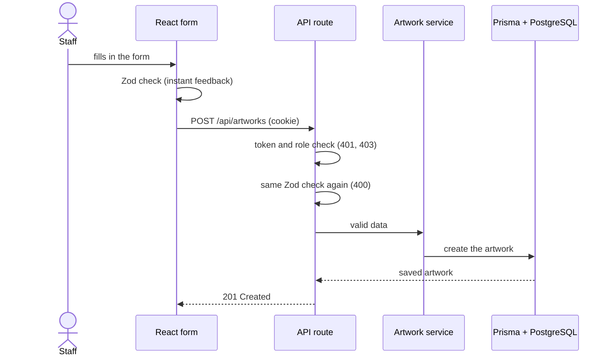

# The Five Doors

[](https://github.com/8-relaunch-8/the-five-doors/actions/workflows/ci.yml) [](LICENSE)

A full-stack web app to manage a museum's art collection. Visitors create an account; staff catalogue and edit artworks in a protected admin area.

I built it to learn the backend in depth, so authentication and roles are written by hand rather than delegated to a service.

## What it does

- **Accounts**: register, log in, log out, view your profile.
- **Roles**: `VISITOR`, `STAFF`, `ADMIN`. Only staff and admins reach the admin area.
- **Artworks**: anyone can list (paginated) and view them; staff and admins create, edit and delete them, from the admin UI or the REST API.

## Architecture

What happens when a staff member creates an artwork:



The same Zod schema runs twice: in the browser for comfort, on the server for safety, because a request can skip the form. Before any of this, the middleware keeps visitors without the right role away from the admin pages.

## Key choices

- **JWT in `httpOnly` cookies**: a 15-minute access token and a 7-day refresh token, unreadable by page scripts. Passwords hashed with bcrypt.
- **Two checks**: the middleware guards pages, and the API routes check the token and the role again, so calling the API directly does not bypass the rules (one exception, see the limitations).
- **Two JWT libraries, on purpose**: the middleware runs on the Edge runtime, which has no Node.js `crypto`, so it uses `jose`; the API routes run on Node.js and use `jsonwebtoken`.
- **Server-side validation** with Zod, and clear status codes (`400`, `401`, `403`, `404`, `409`).

Details and diagrams: [docs/authentication.md](docs/authentication.md).

## Quality

77 tests (Vitest, Testing Library) on API routes and UI components. CI runs lint, type check, tests and build on every pull request, and `main` only accepts green pull requests. Dependencies are kept up to date by Dependabot, and code is scanned by CodeQL.

## Known limitations

- **The account deletion route has no access control** and deletes a hard-coded user: [#22](https://github.com/8-relaunch-8/the-five-doors/issues/22), my next task.
- The refresh route exists, but the front end never calls it, so a session ends after 15 minutes.
- Bookings and exhibitions are modelled in the database, but no page or API uses them yet.
- The Supabase client code is gone, but its packages are still declared in `package.json`.
- The project runs on Next.js 16, which deprecates `middleware.ts` in favour of `proxy.ts`; the file still has the old name.

## How I worked

I built this project on my own, from January to March 2026: a first Express server, then a move to Next.js, a hand-written JWT authentication, a layered architecture, and the artwork admin. I wrote the code myself and used an LLM as a mentor, to explain concepts, review my code and compare options.

In October and November 2026, I came back to it to upgrade the dependencies and write this documentation, working with Claude (Anthropic's AI assistant). Those commits list Claude as their author or co-author.

## Run it locally

Requires Node.js 24 and a PostgreSQL database.

```bash
npm install
cp .env.example .env    # then fill in the values
npm run db:migrate      # apply the migrations
npm run db:seed         # optional: sample data
npm run dev             # http://localhost:3000
```

## License

MIT
