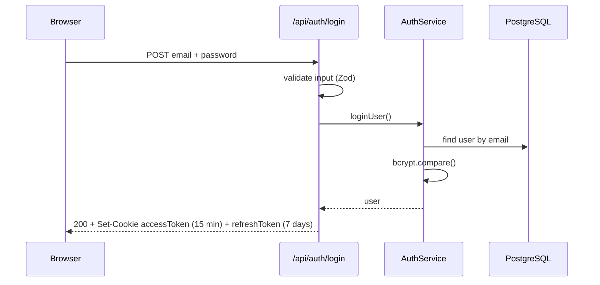
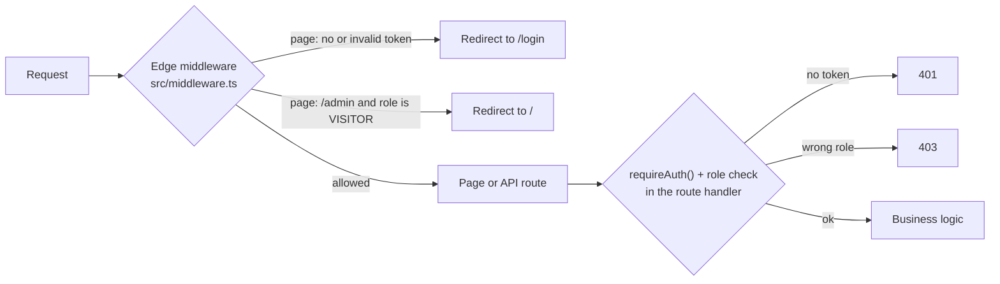

# Authentication and authorization

This document explains how a user proves who they are (**authentication**) and what they are allowed to do (**authorization**) in The Five Doors. It describes the code as it is today, including its known gaps.

## Two questions, two mechanisms

- **Authentication — "who are you?"** Email and password, then two JSON Web Tokens (JWT) stored in cookies.
- **Authorization — "what may you do?"** Role-based access control (RBAC): every account has one role, and each protected page or API route checks it.

## The two tokens

| | Access token | Refresh token |
| --- | --- | --- |
| Lifetime | 15 minutes | 7 days |
| Payload | `userId`, `email`, `role` | `userId` |
| Signed with | `JWT_SECRET` | `JWT_REFRESH_SECRET` |
| Sent | with every request (cookie) | only useful to `/api/auth/refresh` |

Both are signed with an issuer and an audience, and both live in cookies set with:

- `httpOnly`: page scripts cannot read them, which limits the damage of an XSS flaw;
- `sameSite: 'strict'`: the browser does not send them from another site, which blocks CSRF;
- `secure` in production: sent over HTTPS only.

Passwords are hashed with bcrypt (cost factor 10) before they reach the database.

## Login flow

## Two checks: page guard and API guard

- The **middleware** runs on the Edge runtime, which has no Node.js `crypto` module, so it verifies the token with `jose`. It only guards **pages**.
- The protected **API routes** check the token again with `requireAuth()` (`jsonwebtoken`, Node.js runtime) and then the role. Calling them directly therefore does not bypass the rules (defense in depth). One exception: the account deletion route ([#22](https://github.com/8-relaunch-8/the-five-doors/issues/22)).

## Roles

| Role | Who | Can do |
| --- | --- | --- |
| *(no role)* | anonymous visitor, not logged in | browse public pages |
| `VISITOR` | any registered account (default role) | public pages + own profile |
| `STAFF` | museum staff | everything above + admin area (artwork CRUD) |
| `ADMIN` | administrator | today, the same rights as `STAFF` |

## Logout

`POST /api/auth/logout` deletes both cookies.

## Known gaps

- **The refresh route exists but no client calls it.** `/api/auth/refresh` issues a new access token from a valid refresh token, but the front end never calls it. When the access cookie expires after 15 minutes, the middleware sees no token and redirects to `/login`: the session effectively lasts 15 minutes.

## References

- [RFC 7519 — JSON Web Token](https://www.rfc-editor.org/rfc/rfc7519)
- [Next.js — Authentication guide](https://nextjs.org/docs/app/guides/authentication)
- [OWASP — Authentication Cheat Sheet](https://cheatsheetseries.owasp.org/cheatsheets/Authentication_Cheat_Sheet.html)
- [OWASP — Session Management Cheat Sheet](https://cheatsheetseries.owasp.org/cheatsheets/Session_Management_Cheat_Sheet.html)
